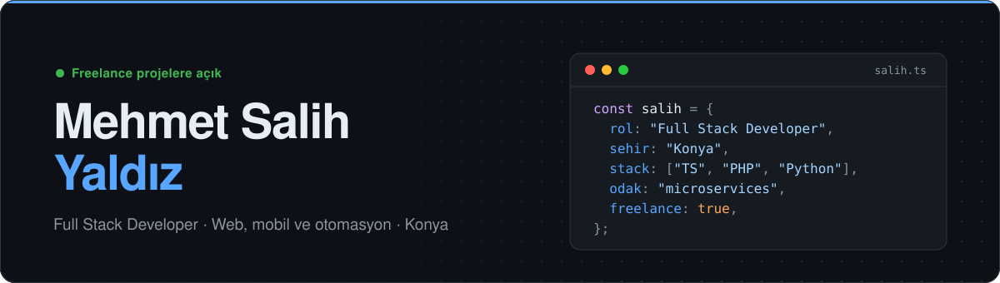

<picture>
  <source media="(prefers-color-scheme: dark)" srcset="assets/header-dark.svg" />
  <source media="(prefers-color-scheme: light)" srcset="assets/header-light.svg" />
  
</picture>

  <a href="https://msydeveloper.com"><b>msydeveloper.com</b></a>
  &nbsp;·&nbsp;
  <a href="https://linkedin.com/in/mehmetsalihyaldiz"><b>LinkedIn</b></a>

 

Merhaba, ben **Salih**. İşitme engelli bir yazılımcıyım. İşletmelerin günlük işini kolaylaştıran yazılımlar geliştiriyorum: veritabanı tasarımından arayüze, sunucudan yayına kadar her katmanda çalışıyorum.

| | |
| --- | --- |
| **İşletme sistemleri** | Stok, fatura, rapor, broşür ve takip panelleri |
| **Otomasyon** | Playwright ve Python ile tarayıcı otomasyonu, veri toplama araçları |
| **3D ve etkileşim** | Three.js ile ürün vitrinleri ve kaydırmaya bağlı animasyonlu siteler |
| **Erişilebilirlik** | İşitme engelli topluluklar ve dernekler için web projeleri |

## Öne çıkan projeler

Çoğu müşteri projesi olduğu için kodları gizli. Demo ya da detay için <a href="https://msydeveloper.com">msydeveloper.com</a> üzerinden yazabilirsin.

<table>
  <tr>
    <td width="50%" valign="top">
      <h3>Marketing System</h3>
      Mağazalar için broşür yönetim sistemi. Admin panelinden hazırlanan broşürler sunucu tarafında PNG, JPG ve PDF olarak üretiliyor.
        
      <code>TypeScript</code> <code>SSR</code>
    </td>
    <td width="50%" valign="top">
      <h3>GitHub Panel</h3>
      Repoları gezmek ve günlük çalışma disiplinini otomatik takip etmek için kişisel panel.
        
      <code>Bun</code> <code>Hono</code> <code>React</code> <code>SQLite</code>
    </td>
  </tr>
  <tr>
    <td width="50%" valign="top">
      <h3>Yedek Parça Stok Yönetimi</h3>
      Bir yedek parça firması için stok, giriş-çıkış ve Excel aktarımı yapan yönetim sistemi.
        
      <code>Laravel</code> <code>MySQL</code> <code>Docker</code>
    </td>
    <td width="50%" valign="top">
      <h3>Ozan Döviz</h3>
      iOS ve Android için piyasa takibi ve kur çevirici içeren döviz uygulaması.
        
      <code>React Native</code> <code>TypeScript</code>
    </td>
  </tr>
  <tr>
    <td width="50%" valign="top">
      <h3>Earth</h3>
      Kaydırdıkça dönen 4K60 Dünya sitesi. NASA SVS görüntüleriyle hazırlandı.
        
      <code>Bun</code> <code>React</code>
    </td>
    <td width="50%" valign="top">
      <h3>Sports 3D</h3>
      32 spor dalı, her biri için prosedürel olarak üretilen 3D ekipman ve kart açılma efekti.
        
      <code>Three.js</code> <code>JavaScript</code>
    </td>
  </tr>
</table>

## Teknolojiler

  
   
  

Bunlara ek olarak: React Native, Hono, Playwright, FFmpeg.

## Şu an öğrendiklerim

Microservices mimarisi, Kubernetes ve cloud native uygulama geliştirme.

## Aktivite

  

---

  Bir projen mi var? <a href="https://msydeveloper.com"><b>msydeveloper.com</b></a> üzerinden ulaşabilirsin.

